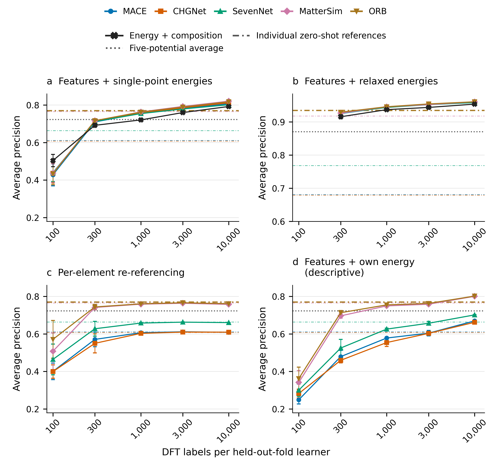

# mlip-label-budget-rule

Code and numerical evidence for two fixed label-budget rules for correcting machine-learned interatomic potential stability scores. The primary population contains 172,689 candidate crystals. Average precision (AP) measures how well a score ranks structures whose density functional theory hull distance is at most zero. A label is one structure's reference formation energy and stability outcome. Five frozen source encoders, chemical-system splits, label draws and fitted models define the scope of the comparisons.

The original **v2.3.1 rule** compares corrections against the best of five single-point energy references. It requires the low-budget contender maximum to receive DOES_NOT_EXCEED at both 300 and 1,000 labels, and at least one fixed feature correction to receive ADDS at 10,000 labels. The strongest primary reference is ORB, AP **0.7699626212297794**. Both low-budget requirements and all five feature-correction high-budget requirements are met. The exact increments and readings appear in the generated table below.

The separate **v2.4 extension** asks whether correction still helps after using relaxed energy predictions. It compares high-budget corrections against the maximum AP among twelve label-free scores: five single-point references, five relaxed references and their two arithmetic-mean ensembles. Relaxed ORB is the strongest primary reference, AP **0.9349424282920303**. The low-budget contender maximum contains five fixed feature-plus-relaxed-energy corrections, a composition-plus-relaxed-energy correction and the relaxed ensemble. Both low-budget requirements and all five feature-correction high-budget requirements are met. The composition correction alone does not satisfy the high-budget rule. The 3,000-label comparison is reported but is outside both rules.

ADDS means evidence for an AP increment above the practical margin **0.02**, using all required reference comparisons and the specified Holm adjustment. DOES_NOT_EXCEED means evidence that the increment is below that margin; it does not establish equality or a negative increment. INCONCLUSIVE meets neither directional condition. The two rules have separate judges. Secondary campaign results, full fine-tuning and mechanism analyses do not substitute for either primary rule.

These are **confirmatory, exposure-informed** comparisons. Earlier results on the same population informed the questions and some choices. The extension question was prompted by previously seen reference performance, and the relaxed ORB rank was known when it was fixed. The tests for the new correction arms were specified before their evaluation. The comparisons are conditional on fitted models and five fixed label draws. Oracle and contender-maximum percentile bands are descriptive nominal summaries, with potentially poor coverage at ties. Encoder training-set overlap is unverified; relaxed-reference checkpoint identity with the frozen encoders is assumed, not proven. Feature-plus-energy stacks do not isolate the contribution of encoder features. The low-budget conclusion is limited to the specified contender sets and the fixed heads.

All six original stages and the appended CPU-R stage are terminal in this release. Fine-tuning is reported against matched source references, outside the primary rules. Mechanism results use all outer-training rows and are descriptive.

## Limitations

These results come from an exposure-informed evaluation of a previously analysed population. Earlier performance on the same candidates was known when parts of the comparison were specified. The results concern five frozen label draws, with inference conditional on the fitted models. The uncertainty calculations do not cover retraining, fresh label draws or model-selection variability.

The conclusions apply only to the tested label budgets and correction methods. At 10,000 labels, the corrections to relaxed references clear the practical margin with only small headroom. The tested budgets do not locate a continuous threshold at which corrections start to help. No unseen-system comparison establishes exceedance of the margin; the high-budget feature classifiers are inconclusive.

The relaxed predictions were taken from released prediction tables. Their checkpoint identity is assumed, rather than proven, to match the frozen encoders. Overlap between the original model training sets and this evaluation population has not been verified.

## Reported readings

<!-- BEGIN GENERATED TABLES -->

Values below are copied as round-trip decimal values from the released readings; no new fitting or inference is performed.

| Stage | Design | Family | Contrast | AP increment | Reading |
|---|---|---|---|---:|---|
| CPU-P | P | F1 | A5f_mace_medium@10000 | 0.037875176197395666 | ADDS |
| CPU-P | P | F1 | A5f_chgnet@10000 | 0.04206104833640545 | ADDS |
| CPU-P | P | F1 | A5f_sevenn@10000 | 0.03161324307778024 | ADDS |
| CPU-P | P | F1 | A5f_mattersim_5m@10000 | 0.050744908657458954 | ADDS |
| CPU-P | P | F1 | A5f_orb@10000 | 0.04786280513105046 | ADDS |
| CPU-P | P | F1 | A4_hist_gbm@10000 | 0.02243625471441879 | ADDS |
| CPU-P | P | F2 | max@300 | -0.026163218758615603 | DOES_NOT_EXCEED |
| CPU-P | P | F2 | max@1000 | -0.00668200048177825 | DOES_NOT_EXCEED |
| CPU-P | P | F2 | max@3000 | 0.022792093630568777 | DESCRIPTIVE_ADDS |
| FT-P | P | F4 | FT_mace_medium@1000 | -0.008265483052918077 | DOES_NOT_EXCEED |
| FT-P | P | F4 | FT_orb@1000 | -0.003520576744751147 | DOES_NOT_EXCEED |
| FT-P | P | F4 | FT_mace_medium@3000 | 0.00949547560416042 | DOES_NOT_EXCEED |
| FT-P | P | F4 | FT_orb@3000 | 1.262276229208048e-06 | DOES_NOT_EXCEED |
| CPU-R | P | F5 | A5fR_mace_medium@10000 | 0.02371826133959143 | ADDS |
| CPU-R | P | F5 | A5fR_chgnet@10000 | 0.02478197491308054 | ADDS |
| CPU-R | P | F5 | A5fR_sevenn@10000 | 0.023548190939072455 | ADDS |
| CPU-R | P | F5 | A5fR_mattersim_5m@10000 | 0.025771337493746493 | ADDS |
| CPU-R | P | F5 | A5fR_orb@10000 | 0.0259473898867012 | ADDS |
| CPU-R | P | F5 | A4R@10000 | 0.018917566488190762 | INCONCLUSIVE |
| CPU-R | P | F6 | max@300 | -0.0054509237476135786 | DOES_NOT_EXCEED |
| CPU-R | P | F6 | max@1000 | 0.010987888392634315 | DOES_NOT_EXCEED |
| CPU-R | P | F6 | max@3000 | 0.019460879250741803 | INCONCLUSIVE |

Secondary readings are in the corresponding `results/CPU-S`, `results/FT-S` and `results/CPU-R/readings.json` files. Their designs and family adjustments remain separate from the primary rules.

| Rule | Status | Low-budget requirements met | Qualifying high-budget contrasts |
|---|---|---|---|
| v2.3.1 | SUCCESS | {"1000": true, "300": true} | ["A5f_mace_medium@10000", "A5f_chgnet@10000", "A5f_sevenn@10000", "A5f_mattersim_5m@10000", "A5f_orb@10000"] |
| v2.4 extension | SUCCESS | {"1000": true, "300": true} | ["A5fR_mace_medium@10000", "A5fR_chgnet@10000", "A5fR_sevenn@10000", "A5fR_mattersim_5m@10000", "A5fR_orb@10000"] |

<!-- END GENERATED TABLES -->

## Install

Use Python 3.10.12. The light CPU environment is sufficient for the CPU stages, CPU-R, archived-inference replay, protocol checks and synthetic checks:

```bash
python3.10 -m venv .venv-cpu
.venv-cpu/bin/python -m pip install -r requirements-cpu.txt
export PYTHON="$PWD/.venv-cpu/bin/python"
export PYTHONDONTWRITEBYTECODE=1 CUDA_VISIBLE_DEVICES=''
export OMP_NUM_THREADS=1 OPENBLAS_NUM_THREADS=1 MKL_NUM_THREADS=1 NUMEXPR_NUM_THREADS=1 BLIS_NUM_THREADS=1
export HF_HUB_OFFLINE=1 TRANSFORMERS_OFFLINE=1 WANDB_MODE=disabled
export PYTHONPATH="$PWD/pipeline:$PWD/src"
```

The preserved model environments are needed only for feature regeneration or fine-tuning. MACE, CHGNet and ORB use `requirements-analysis.txt` (e3nn 0.4.4); SevenNet and MatterSim use `requirements-e3nn.txt` (e3nn 0.6.0). These are separate environments because their model dependencies differ. Their recorded rebuild uses:

```bash
uv venv --python 3.10.12 .venv-analysis
uv pip install --python .venv-analysis/bin/python --index-strategy unsafe-best-match --extra-index-url https://download.pytorch.org/whl/cu128 -r requirements-analysis.txt
uv venv --python 3.10.12 .venv-e3nn
uv pip install --python .venv-e3nn/bin/python --index-strategy unsafe-best-match --extra-index-url https://download.pytorch.org/whl/cu128 -r requirements-e3nn.txt
```

`requirements-docs.txt` preserves the earlier plotting environment. No weights are included in the repository or archive. Upstream software, checkpoints and input licences are listed in [DATA_SOURCES.md](DATA_SOURCES.md).

## Restore and reproduce

Repository: <https://github.com/wwhite777/mlip-label-budget-rule>. Versioned archive DOI: **10.5281/zenodo.23944808**. Predecessor: **10.5281/zenodo.23151416**. Release: **v1.0.1** (https://github.com/wwhite777/mlip-label-budget-rule/tree/v1.0.1).

Obtain the archive's small control files and all tar parts. From their parent directory:

```bash
python3 zenodo_v3/restore.py --parts-root parts --out-root restored
cp -a restored/cache restored/data restored/result restored/code/
cd restored/code
```

If using a separate repository checkout, copy the three restored data directories into that checkout instead. The archive contains frozen features, split manifests, single-point and relaxed prediction tables, per-unit predictions, bootstrap arrays and inference inputs for every stage. The protocol files are cleaned views of the frozen originals. `ORIGINAL_HASHES.json` binds them to the original identities; `TRANSFORMATIONS.md` lists the changes. The exact originals are available on request. Raw publisher downloads and checkpoint weights are obtained separately and are unnecessary for replaying the archived inference.

Check the restored outputs and reproduce all practical readings and both judges without opening label files:

```bash
"$PYTHON" tools/check_protocol.py
"$PYTHON" tools/check_stages.py
"$PYTHON" tools/replay_readings.py --out-root runs/replayed
"$PYTHON" reporting/readme_tables.py --check
```

To refit the CPU stages, obtain the byte-exact publisher inputs in `data_sources.json`, then use a fresh destination:

```bash
"$PYTHON" tools/download_inputs.py
"$PYTHON" tools/check_inputs.py --kind cpu
"$PYTHON" -m confirm_runner.runner --stage CPU-P --stage-root runs/stages --out-root runs/stages/CPU-P --workers 7
"$PYTHON" -m confirm_runner.runner --stage CPU-S --stage-root runs/stages --out-root runs/stages/CPU-S --workers 7
"$PYTHON" -m confirm_runner.relaxed --stage CPU-R --stage-root data/stages --out-root runs/extension/CPU-R --workers 7
```

CPU-P also writes the original judge. The standalone CPU-R command verifies the complete restored predecessor chain through mechanism, and writes to a separate output root. Full fine-tuning, mechanism and feature-regeneration commands, and the distinction between inference replay and new fitting, are in [REPRODUCTION.md](REPRODUCTION.md).

## Tests and integrity

```bash
"$PYTHON" tools/check_public.py --all-files --self-test
"$PYTHON" -m pytest -q -p no:cacheprovider tests
"$PYTHON" tools/synthetic_cpu.py --out-root runs/synthetic --workers 7
"$PYTHON" tools/synthetic_cpu_r.py --out-root runs/synthetic_extension/CPU-R --workers 7
"$PYTHON" tools/judge_smoke.py --out-root runs/judge
sha256sum -c SHA256SUMS
```

Run the public-file check on the pristine distribution, before adding locally downloaded inputs or execution outputs. The planted controls are created in temporary scratch and removed. Synthetic checks generate artificial data and labels, exercise the fitting and inference code and cannot authorize a scientific reading. Native numerical libraries use one thread per worker; the documented settings stay below twelve CPU threads. The mechanism command in the reproduction guide uses one worker with four native threads.

`PROTOCOL_SHA256` binds both cleaned protocols and contracts. `pipeline/release_integrity.json` binds executable sources. Restored stage manifests bind every exported scientific output and the local predecessor chain. New runs have different runtime metadata; numerical arrays and readings should be compared separately. `PUBLIC_FILES.json` inventories the exact repository files; `SHA256SUMS` hashes them. The corresponding archive files and chunks are enumerated in its manifest.

Code: MIT, copyright 2026 Woncheol Jeong. Derived numerical data: CC BY 4.0, with upstream WBM/Matbench Discovery attribution. Please cite this version using [CITATION.cff](CITATION.cff). The authors are Woncheol Jeong and Hayoung Oh, Sungkyunkwan University.
